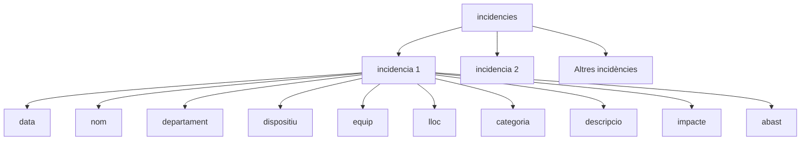
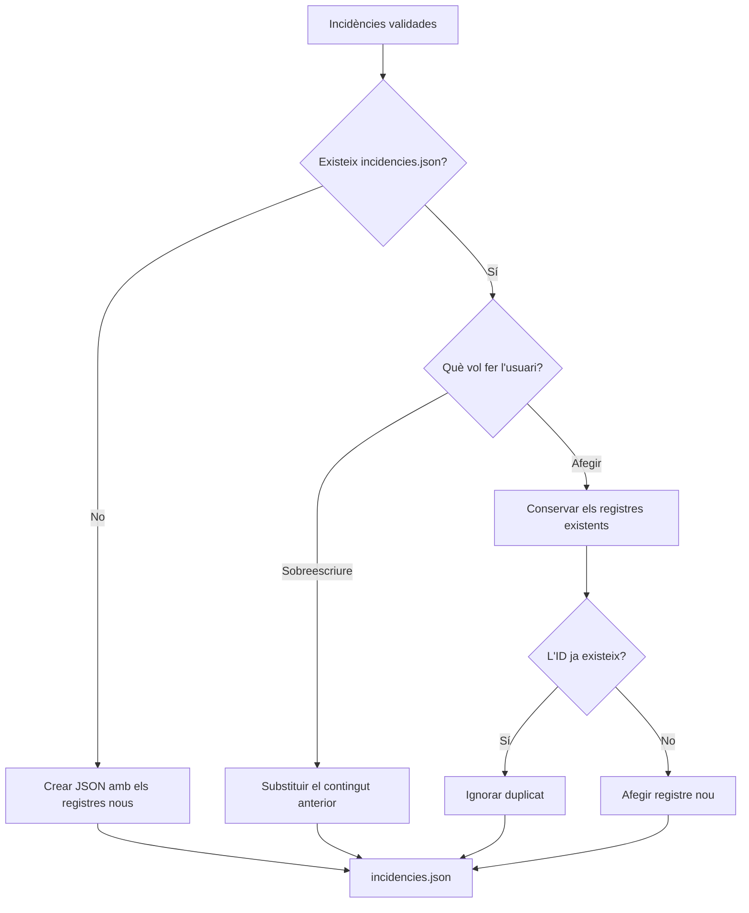
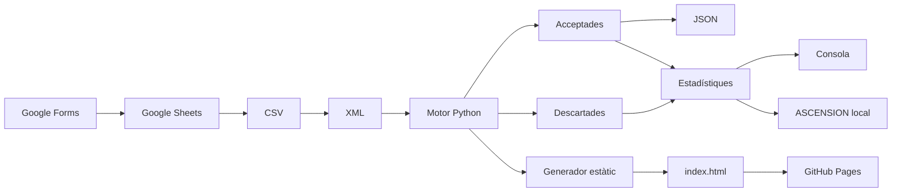

<div align="center">

# TA04 · Programació i Llenguatges de Marques

## ⚡ CYBER-CORE v8.0 — ASCENSION EDITION

**Observatori d'incidències informàtiques i audiovisuals**


**De les dades crues a la informació útil.**

[Repositori del projecte](https://github.com/ITB2627-VallejoSantiago/ta04-g3-VallejoSantiago-NoeliaJover-1ASIXBc) · [Observatori web (adreça prevista de GitHub Pages)](https://itb2627-vallejosantiago.github.io/ta04-g3-VallejoSantiago-NoeliaJover-1ASIXBc/)

</div>

---

## 00 · Identificació i objectiu

| Camp | Informació |
|---|---|
| Activitat | TA04 — Programació i Llenguatges de Marques |
| Mòdul | 0373 · Llenguatge de Marques |
| Curs | 2026–2027 |
| Professor | Javier Amaya |
| Centre | ITB Barcelona |
| Grup | G3 · ASIXc1B |
| Membres | Santiago Vallejo i Noelia Jover |
| Projecte | CYBER-CORE v8.0 · ASCENSION EDITION |

L'objectiu és desenvolupar un sistema per recollir incidències d'equipaments informàtics o audiovisuals, transformar les dades en formats oberts, validar-les, obtenir estadístiques significatives i emmagatzemar la informació resultant en JSON.

El projecte treballa amb més de 4.400 registres del conjunt de dades de l'activitat, segons el recompte del projecte. Les xifres exactes de registres acceptats i descartats es calculen a partir del fitxer XML carregat. No s'han de confondre els registres del projecte amb els d'una demostració ni amb incidències reals verificades d'una empresa.

L'aplicació de consola Python és la base dels requisits obligatoris. L'aplicació d'escriptori i l'observatori ASCENSION són ampliacions que faciliten l'anàlisi i la presentació.

## 01 · Rúbrica i traçabilitat dels requisits

La qualificació de la tasca es distribueix en un **70% corresponent als RA i un 30% a les capacitats transversals**. Cada funcionalitat es valora en dos aspectes amb el mateix pes entre ells.

| Funcionalitat | Aspecte 1 | Aspecte 2 | Evidència del projecte |
|---|---|---|---|
| **F1** | Formulari | Dades CSV (100–400) | Google Forms, full de càlcul, `incidencies.csv` |
| **F2** | Conversió CSV a XML | Diagrama de l'arbre XML | `incidencies.xml`, `diagrama_xml.png` |
| **F3** | Informació amb format | Anàlisi i estadístiques | `analitzar_incidencies.py`, sortida de consola |
| **F4** | Creació de JSON | Comprovacions del fitxer | `incidencies.json`, proves de creació, sobreescriptura i incorporació sense duplicats per ID |
| **F5** | Lliurament | Presentació | ZIP, documents separats i material de suport; exposició de màxim 4 minuts |

Aquesta taula identifica els elements que cal mostrar per acreditar cada requisit; no substitueix les proves d'execució ni la comprovació final dels lliuraments.

## 02 · F1 — Obtenció de dades

### Formulari d'incidències

El formulari de Google Forms està orientat al registre de problemes de suport informàtic. Les respostes es recullen en un full de càlcul de Google i s'exporten al fitxer obligatori `incidencies.csv`.

L'enunciat demana publicar el formulari a classe i que cada participant informi almenys de **100 incidències a cadascun dels formularis dels altres grups**, amb un objectiu ideal de 400. El volum total del nostre conjunt de dades supera aquesta referència, però el recompte global no acredita per si sol la participació individual en els altres formularis.

### Camps de cada incidència

L'estructura de treball utilitza els deu camps següents, tal com apareixen al panell web:

| Camp XML | Finalitat |
|---|---|
| `data` | Data i hora del registre |
| `nom` | Usuari que comunica la incidència |
| `departament` | Departament afectat |
| `dispositiu` | Tipus de dispositiu |
| `equip` | Identificació de l'equip |
| `lloc` | Ubicació del problema |
| `categoria` | Classificació de la incidència |
| `descripcio` | Descripció del problema |
| `impacte` | Afectació sobre el treball |
| `abast` | Abast de la incidència |

Aquests camps permeten identificar què ha passat, on, quan i quina afectació té. La persistència JSON utilitza l'identificador de registre que estableix el motor original per controlar duplicats.

**Evidències F1:** formulari publicat, full de càlcul, CSV i captures identificades amb el nom d'usuari o la fotografia de perfil.

## 03 · F2 — Migració de CSV a XML

El fitxer `incidencies.csv` es transforma en `incidencies.xml`, amb una arrel comuna i un element per incidència. Això permet representar les dades amb una estructura jeràrquica i processar-les posteriorment amb Python.

### Arbre XML



Cada element `incidencia` comparteix la mateixa estructura. Aquest esquema complementa el diagrama gràfic del projecte, `diagrama_xml.png`, que cal incloure en el lliurament.

### Verificació i privacitat

- Obrir l'XML amb Firefox o VS Code per comprovar que està ben formatat.
- Comprovar l'arrel, els elements obligatoris i l'estructura de cada registre amb el motor Python.
- Respectar la codificació dels caràcters i el tractament de valors especials.
- Fer la conversió CSV → XML localment. **L'enunciat prohibeix utilitzar IA (ChatGPT, Gemini o similars) per a aquesta transformació per motius de privacitat.** No s'han de proporcionar dades personals del formulari a aquestes eines.

La comprovació programàtica de l'estructura no equival a una validació amb XSD o DTD. No es pressuposa l'existència d'un esquema formal si no s'ha incorporat al projecte.

**Evidències F2:** CSV d'origen, XML resultant, diagrama i captures del procés de conversió i comprovació.

## 04 · F3 — Processament, informació i estadístiques

El programa principal `analitzar_incidencies.py` llegeix l'XML, neteja i valida els registres i presenta els resultats per consola amb format llegible (colors, taules i percentatges). La interfície web reutilitza aquest motor, no el substitueix.

### Quina diferència hi ha entre dades i informació?

- **Dades:** valors individuals encara no interpretats, com ara `PC-67`, `Perifèrics` o una data de registre.
- **Informació:** dades validades, agrupades i contextualitzades que permeten obtenir conclusions. Per exemple, el percentatge d'incidències que afecten un tipus de dispositiu o el departament amb més incidències.

### Filtratge i qualitat de les dades

El motor permet separar els registres útils dels incorrectes. Entre les anomalies descrites al projecte hi ha dates incoherents (per exemple, l'any 2064), descripcions buides, genèriques o inferiors a 15 caràcters i registres duplicats. L'observatori també detecta entrades amb una estructura XML incorrecta. Les regles concretes de negoci són les implementades a `analitzar_incidencies.py`.

Aquest procés evita el principi **GIGO — Garbage In, Garbage Out**: si les dades d'entrada són incorrectes, els resultats estadístics també ho poden ser.

### Estadístiques significatives

| Indicador | Utilitat |
|---|---|
| Total, acceptades i descartades | Conèixer el volum i la qualitat del conjunt |
| Percentatge de registres vàlids | Mesurar la proporció de dades que superen la validació |
| Distribució per categoria | Detectar els tipus de problema més freqüents |
| Distribució per dispositiu | Prioritzar equipaments que concentren incidències |
| Impacte sobre el treball | Identificar el grau de bloqueig de l'activitat |
| Abast de l'afectació | Diferenciar problemes individuals i col·lectius |
| Departament i evolució temporal | Detectar concentracions i tendències en el conjunt de dades |

Les visualitzacions avançades d'ASCENSION complementen les estadístiques de consola. La ràtio d'integritat representa el percentatge de registres acceptats respecte del total carregat; no certifica que les dades siguin verídiques ni lliures de qualsevol error.

```bash
python3 analitzar_incidencies.py incidencies.xml
```

**Evidències F3:** codi Python, captures de la sortida de consola amb les estadístiques i exemples de registres rebutjats amb els motius corresponents.

## 05 · F4 — Emmagatzematge de la informació en JSON

El resultat de la validació s'emmagatzema en el fitxer obligatori `incidencies.json`. La funcionalitat de persistència es centralitza en l'exportador del motor Python original (`exportar_json`).

El comportament requerit és:



Execució des de la consola, segons l'opció d'exportació del programa original:

```bash
python3 analitzar_incidencies.py incidencies.xml --export-json
```

### Proves que acrediten F4

| Prova | Resultat esperat |
|---|---|
| El fitxer JSON no existeix | Es crea amb les incidències validades |
| El fitxer existeix i es tria sobreescriure | El contingut anterior se substitueix |
| El fitxer existeix i es tria afegir | Es conserven les incidències anteriors i s'incorporen les noves |
| Es torna a incorporar una incidència amb el mateix ID | No es crea una entrada duplicada |

Per comprovar aquests casos, és recomanable treballar amb una còpia de prova i conservar l'original. Cal aportar captures dels resultats reals: aquesta taula descriu les proves, no afirma que s'hagin executat totes.

**Important:** la versió local Python és la que permet demostrar l'escriptura real al sistema de fitxers i les comprovacions F4. GitHub Pages no pot executar Python ni modificar el JSON del repositori des del navegador.

## 06 · F5 — Lliurament i presentació final

### Lliurament a Classroom

El projecte és un treball en grup. Només un membre de l'equip ha de fer el lliurament de grup i indicar en el comentari privat:

```text
Grup: G3
Membres: Santiago Vallejo i Noelia Jover
```

La nomenclatura obligatòria del projecte és `taXX-gXX-cognomNom-cognomNom-grupDeClasse` i el ZIP ha de mantenir el mateix nom. Per al grup 3, un nom que segueix l’ordre cognom-nom és `ta04-g3-VallejoSantiago-JoverNoelia-1ASIXBc.zip`. Abans de lliurar-lo, cal confirmar l'ordre cognom-nom i la denominació exacta del grup exigits pel professor; la plantilla demana cognom abans del nom per a tots els membres.

Lliuraments requerits:

- [ ] ZIP amb tot el projecte i els fitxers necessaris per executar-lo.
- [ ] Documents demanats, també per separat.
- [ ] Material de suport utilitzat durant la presentació final.
- [ ] Captures de pantalla amb la fotografia de perfil o nom d'usuari visible.
- [ ] Revisió de la nomenclatura i del comentari privat de grup.

### Presentació: màxim 4 minuts per equip

Es valoren l'expressió oral, el coneixement del tema de cada membre, la qualitat del material de suport i l'ajust al temps. Després de l'exposició hi ha torn de preguntes. Tots els membres han de conèixer el projecte complet. Les presentacions es fan en castellà, català i anglès de manera rotativa, segons el torn assignat.

Proposta orientativa de distribució del temps (no és una exigència de la rúbrica):

| Temps | Contingut |
|---|---|
| 00:00–00:45 | Objectiu i obtenció de dades (F1) |
| 00:45–01:25 | Conversió i arbre XML (F2) |
| 01:25–02:40 | Validació, consola i estadístiques (F3) |
| 02:40–03:30 | Creació i comprovacions JSON (F4) |
| 03:30–04:00 | Conclusions i demostració de l'observatori |

ASCENSION incorpora un temporitzador de compte enrere de quatre minuts amb un HUD permanent que es manté visible en canviar de secció, controls de pausa i represa, i avisos durant l'últim minut i els últims 30 segons.

## 07 · Arquitectura i estructura del projecte



```text
Projecte TA04/
├── incidencies.csv
├── incidencies.xml
├── incidencies_filtrades.xml
├── incidencies.json
├── diagrama_xml.png
├── analitzar_incidencies.py
├── interfaz_incidencies.py
├── interfaz_web.py
├── interfaz_web_pro.py
├── publicar_ascension.py
├── index.html
├── OBRIR_APP.bat
├── .github/workflows/static.yml
└── README.md
```

| Fitxer | Funció |
|---|---|
| `incidencies.csv` | Exportació del formulari (F1) |
| `incidencies.xml` | Dades estructurades (F2) |
| `diagrama_xml.png` | Diagrama gràfic XML (F2) |
| `incidencies_filtrades.xml` | Conjunt de dades filtrades disponible al projecte |
| `analitzar_incidencies.py` | Motor de consola, validació, estadístiques i exportació (F3/F4) |
| `incidencies.json` | Persistència de la informació (F4) |
| `interfaz_incidencies.py` | Aplicació d'escriptori Tkinter |
| `interfaz_web.py` | Interfície web Python addicional del repositori |
| `interfaz_web_pro.py` | Servidor local ASCENSION v8.0 |
| `publicar_ascension.py` | Generador de la web estàtica amb dades del projecte |
| `index.html` | Observatori estàtic generat per a GitHub Pages |
| `OBRIR_APP.bat` | Llançador de l'aplicació a Windows |
| `.github/workflows/static.yml` | Desplegament de la web amb GitHub Actions |

L'estructura descriu els fitxers de treball coneguts. Cal comprovar que els scripts locals nous estiguin afegits al repositori i al ZIP, i incorporar-hi els documents, captures i materials de lliurament corresponents.

## 08 · ASCENSION v8.0 — Ampliacions de la tasca

| Mòdul | Funcionalitat |
|---|---|
| Command Center | Comptadors dinàmics i qualitat de les dades |
| Radar hologràfic | Visualització animada de les incidències per categoria; no és un escàner de xarxa |
| Explorador | Cerca global, filtres, ordenació i paginació |
| Dossier forense | Informació detallada de cada registre |
| Telemetria | Gràfics interactius, evolució temporal i mapa de calor |
| Quarantine System | Registres descartats i motius de rebuig |
| Persistence Engine | Vista prèvia i gestió de JSON |
| Presentation HUD | Temporitzador permanent, pantalla completa i controls de temps |
| Temes | NEXUS, PHANTOM i SOLAR |
| Mode discret | Ocultació visual de camps durant l'exposició; no anonimitza els fitxers |
| Teoria | Dades i informació, qualitat i protecció de dades |

Dreceres: `1`–`7` per navegar entre seccions, `/` per a la cerca i `Esc` per tancar el dossier. La interfície és adaptable i utilitza recursos visuals locals.

## 09 · Execució i publicació

Cal disposar de Python 3 i tenir el motor `analitzar_incidencies.py` i els fitxers de dades a la mateixa carpeta. Per a l'escriptori es necessita Tkinter i un entorn gràfic compatible (Windows, Linux o macOS). No s'afirma compatibilitat nativa amb iOS.

### A — Consola (execució principal de la rúbrica)

```bash
python3 analitzar_incidencies.py incidencies.xml
python3 analitzar_incidencies.py incidencies.xml --export-json
```

### B — Escriptori

```bash
python3 interfaz_incidencies.py
```

A Windows també es pot utilitzar `OBRIR_APP.bat`.

### C — Web local ASCENSION

```bash
python3 interfaz_web_pro.py
```

El servidor local obre el navegador automàticament i escolta a `127.0.0.1`. Es pot assignar un port concret amb `python3 interfaz_web_pro.py --port 8080`. Per aturar-lo, prem `Ctrl+C`.

El servidor prioritza `incidencies.xml` i, si no existeix, utilitza `incidencies_filtrades.xml`. Si s'utilitza el fitxer filtrat, no es poden recuperar els registres descartats que ja no hi són presents.

### D — GitHub Pages amb dades del projecte

El generador utilitza el validador i l'exportador originals i incorpora els resultats dins d'un `index.html` estàtic. Per defecte redueix els camps publicats:

```bash
python3 publicar_ascension.py
```

El mode complet (`--dades-completes`) només s'ha d'utilitzar si s'ha verificat que totes les dades són aptes per a la publicació. La reducció de camps no garanteix l'anonimat; cal revisar el resultat abans de publicar-lo. El generador no modifica el JSON original.

Un cop revisat l'HTML:

```bash
git add index.html &&
git commit -m "Update CYBER-CORE ASCENSION data" &&
git push origin main
```

El workflow s'executa en fer push a `main` o manualment des d'Actions. La URL efectiva es consulta a **Settings → Pages → Visit site**.

| Funció | Python local | GitHub Pages |
|---|---|---|
| Validació XML | En carregar l'XML | Prèvia a la generació de l'HTML |
| Estadístiques, radar i filtres | Sí | Sí, sobre les dades incorporades |
| Temporitzador permanent | Sí | Sí |
| Persistència JSON | Escriptura al disc amb el motor original | Importació, gestió en memòria del navegador i descàrrega |
| Actualització de dades | Recarregar l'XML | Regenerar i desplegar l'HTML |

**La web estàtica és un complement, no substitueix els exercicis Python obligatoris F3 i F4.**

## 10 · Relació amb els resultats d'aprenentatge

| RA | Aplicació al projecte |
|---|---|
| RA1 | Identificació de marques, elements i jerarquia XML i HTML |
| RA2 | Presentació d'informació al web mitjançant HTML i CSS |
| RA3 | JavaScript per manipular el DOM, filtrar, visualitzar gràfics i controlar el temporitzador |
| RA4 | Comprovació de l'estructura XML i validació programàtica dels registres |
| RA5 | Conversió CSV → XML i exportació de la informació a JSON |
| RA6 | Lectura, gestió, consulta i emmagatzematge de dades estructurades |

### Capacitats transversals (30% de la rúbrica)

| Capacitat | Pes dins del bloc transversal | Aspectes a evidenciar |
|---|---:|---|
| Autonomia | 33% | Resolució d'errors, presa de decisions, consultes adequades i respecte dels procediments |
| Implicació | 34% | Participació activa, compliment de terminis i normes d'aula |
| Treball en equip | 33% | Repartiment equilibrat, aportacions, coordinació i gestió de conflictes |

El repartiment real de tasques entre els membres s'ha d'acreditar amb la documentació del grup i, quan sigui pertinent, l'historial de Git. No s'atribueixen tasques individuals sense aquesta evidència.

## 11 · Sostenibilitat, digitalització i protecció de dades

Els formats oberts i documentats afavoreixen la reutilització, la interoperabilitat i l'accessibilitat a llarg termini. CSV, XML, JSON, HTML i Markdown permeten consultar les dades sense dependre d'una única aplicació propietària. La codificació Unicode facilita la representació correcta del català i altres idiomes. El text sense compressió és fàcil d'inspeccionar; el ZIP es reserva al lliurament requerit.

En relació amb la sostenibilitat i la referència de l'enunciat a l'estudi OnWork IT & Cloud (Microsoft i WSP USA), és pertinent considerar el consum de recursos, l'emmagatzematge i el manteniment de les solucions. Aquest projecte no aporta una mesura d'emissions ni un estudi quantitatiu d'impacte ambiental.

En digitalització, els bons prompts permeten definir objectius, restriccions, formats de sortida i criteris de verificació quan l'ús d'IA està permès. Això no elimina la responsabilitat de revisar el resultat ni la prohibició específica d'utilitzar IA per a la migració de les dades del formulari a XML (F2).

### Seguretat i privacitat

- No proporcionar dades personals del formulari a eines d'IA.
- Revisar els camps, els motius de rebuig i els fitxers abans de publicar-los.
- El mode discret només oculta informació a la pantalla; no evita que es pugui llegir a l'HTML.
- El workflow actual amb `path: '.'` desplega tot el repositori. És recomanable limitar el desplegament a una carpeta amb els recursos públics revisats. Si el repositori és públic, també cal revisar els fitxers originals i l'historial de Git.
- La llicència CC-BY 4.0 indicada a l'enunciat correspon al document docent. No implica automàticament que el codi del projecte o les dades personals tinguin la mateixa llicència.

## 12 · Conclusions

La TA04 integra la recollida d'incidències, la conversió entre formats de dades, el processament amb Python i la persistència JSON. El valor del projecte no és només el disseny visual: és la capacitat de transformar dades crues en informació útil, justificar les decisions de validació i demostrar cada funcionalitat de la rúbrica.

ASCENSION v8.0 amplia el projecte amb un observatori web interactiu i un sistema de control del temps per a la presentació final, mantenint els requisits originals com a base del treball.

---

<div align="center">

**CYBER-CORE v8.0 // ASCENSION**  
TA04 · G3 · ASIXc1B · ITB Barcelona · 2026–2027  
Santiago Vallejo & Noelia Jover

</div>
